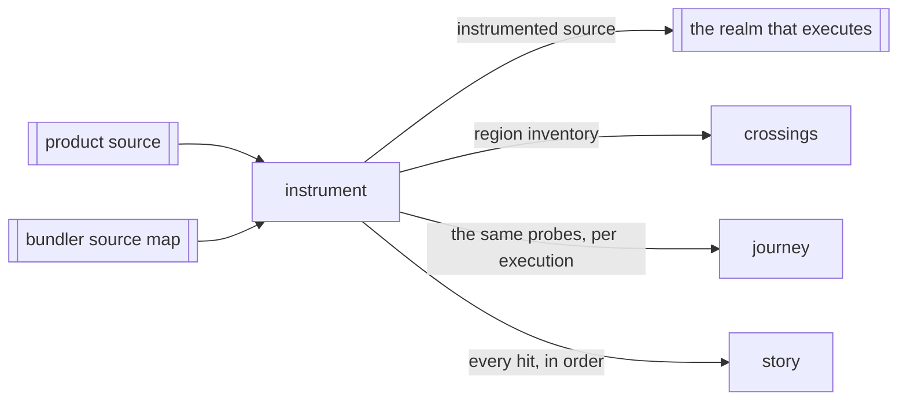

# Instrument

«factory»

## Responsibility

Cuts a module into arrival regions and splices a presence probe in front of each
one, producing the transformed source beside the inventory that says what every
region is. Under the `loads` recipe it does neither: the module keeps its text,
with one line after it that marks it as loaded, and has no inventory.

## Bounded context

[Reach](../../DOMAIN.md#reach)

## Inputs and outputs

In: one module's source text, its id, and — where the project's transforms
already rewrote it — the transformed text and the composed map from it back to
the source text. Out: the text with probes spliced in, the map from it back to
what it was spliced into, and one entry per region carrying its
ordinal, its kind, its name and path, its extent in the author's own
coordinates, the digest of its own source with child bodies excluded, and the
ordinal of the region enclosing it. Also out: the identity of the exact input,
and the identity of the probe recipe. For a test file, under a test-runner seam
with cadence on: the file with a cut before each statement of its test and hook
bodies, which reports the line it stands on, and no probes. Under `loads` the
module text with the load mark after it, the identity of the input, and no
regions; a test file is not cut.

## Depends on

Nothing in this block. It is a pure function of a string, with no disk, no
runner and no index.

## Used by

- [`crossings`](../crossings/README.md) — the inventory that gives an ordinal a
  name, a span and a digest
- [`journey`](../journey/README.md) — the same probes, resolved through a
  per-execution factory rather than a per-realm one
- [`story`](../story/README.md) — the same probes, reporting every hit to a
  root that tapes it before the engine sees it

## Boundary

The rule is a single test: a region has exactly one arrival condition, and a
probe is placed only where control can diverge. Entering a `try` follows
from entering the region around it, so it gets nothing; entering its `catch`
does not, so it gets a probe. That test — *does reaching here follow from
reaching the enclosing region* — is the whole of the design. Short-circuiting
operators and ternaries belong to the region containing them: which branch ran is the fact
worth recording, and a change to either operand still reaches every test that
evaluated the condition.

A guard belongs to the region before its outcomes, so editing the guard moves
that region's digest while an edit inside one outcome does not.

A module is read in the dialect its extension names, except that `.js`,
`.mjs` and `.cjs` are read with JSX: a React component in a `.js` file is
source, and the probes, the cuts and the scanner's readers share that one rule,
so a region a recording names is the region a reader finds.

A cut is a log length, not a probe: it goes into nested blocks and stops at a
nested function, because the callback a statement hands over is part of that
statement. The close charges each region to the last cut before its first
entry, so a case records which of its own lines, or a hook's, first reached
each region it crossed.

Regions are always cut from the text the author wrote, because a diff speaks
in the coordinates of the file the author edited and extents taken from
transformed text are a different number line rather than an approximation.
The probes go into the transformed text, after every transform of the
project's, so a compiler that reads syntax never reads one: each transformed
region fires the authored regions the composed map names its code as coming
from, and a region the map gives no code of its own is fired by the enclosing
code in front of it. That can report a region running when it did not, never
the reverse. A rewritten text with no map back, or a region nothing fires, is
refused by file and region rather than dropped. No inserted text contains a
newline, except the line a module that is only a hashbang takes its header on,
so lines stay where the transforms put them, and the map handed on is the
project's moved past the probes.

A module that cannot be parsed yields nothing at all, and a missing result is
never an empty region list: only the caller can keep those apart, and it widens
to the whole module. A probe stays in its instrumented realm — source
re-evaluated elsewhere has lost the generated declarations and throws at its
first probe, which makes an incomplete configuration visible rather than
silently dropping evidence. The exception is the one a module's own text
declares: a function it hands to a page through a serializing call, written at
the call or bound in the module, is found from the call and left without a
probe, so its text belongs to the enclosing region and the rest of the module
keeps its probes. A declaration is hoisted, so one written after a branch that
can leave, or under any case of a `switch`, opens a region probed where its
block is entered, and its text is charged to every test that entered the block.
A function written in another module and sent from this one cannot be seen from
either text, and stays the configuration's to exclude.

A module the integration's `unprobed` option names (a predicate in Vitest and
Rstest, globs in Jest) is not probed at all. It runs with a mark at the end of
its text, `path@~digest`, and the join reads that mark as a module loaded
without regions, so a change to it selects every test file that loaded it. A text that cannot be parsed, and one a transformer that places
its own probes handed back with none in it, carry the same mark.

## Implementation coordinates

- `packages/sense/src/instrument/index.ts` — `instrument`, the probe recipe
  identity, and the emitted runtime that re-resolves its counter array whenever
  the factory's identity moves
- `packages/sense/src/instrument/spliced.ts` — the region vocabulary, and the
  addon's columns read back as regions
- `packages/sense/native/instrument/src/walk.rs` — the descent that applies the
  arrival rule, region identity, and where a module header may be inserted
- `packages/sense/native/instrument/src/crossing.rs` — the functions a module
  hands to another realm as text, found from the calls that send them
- `packages/sense/native/instrument/src/place.rs` — `place`: the authored
  cut, placed on the transformed text through the composed map
- `packages/sense/native/instrument/src/carry.rs` — the project's map moved
  past the probes placed in the text it maps
- `packages/sense/src/test-selection/unmapped-transforms.ts` — the plugins
  ahead of the probes that rewrote a module under Vite and returned no map
- `packages/sense/src/test-selection/loader-probes.ts` — the placement every
  Rspack and webpack loader at `enforce: 'post'` shares, through the map the
  loaders ahead handed on; `probes-rule.ts` and `probes-loader.ts` — the rule
  and loader that probe a build no test runner drives
- `packages/sense/native/instrument/src/lib.rs` — the instrumenter crate a Rust
  pipeline links from `node_modules`: `instrument`, `module_id` and `recipe`
- `packages/sense/native/instrument/src/header.rs` — the one author of the
  header every instrumented module carries
- `packages/sense/native/instrument/src/dialect.rs` — the dialect every
  reader of a module parses it in
- `packages/sense/native/instrument/src/cadence.rs` — the cuts placed in a
  test file's test and hook bodies
- `packages/sense/src/instrument/cadence.ts` — the seams' call into it, kept
  off the published `instrument` entry
- `packages/sense/src/instrument/probe-cuts.cts` — a cut at run time: the
  current bucket's log length beside the line
- `packages/sense/src/test-selection/jest-transform.ts` — the handoff: a
  transformer that answers `senseRecipe` with this build's recipe is given
  `senseProbes` and places the probes itself
- `packages/sense/src/test-selection/captured-modules.ts` — one cut per
  module for the transform and the join: `planModule` decides from `include`
  and `unprobed` whether a module is probed, marked or skipped, and
  `markedId`/`markUnplaced` write the `path@~digest` mark
- `packages/sense/src/test-selection/probes.ts` — the build-side plugin: probes in, inventory out
- `packages/sense/src/test-selection/source-lines.ts` — transformed offsets back to authored lines
- `packages/sense/src/test-selection/instrumented-modules.ts` — the inventory as
  it is persisted for a run that has not started yet

## Diagram

