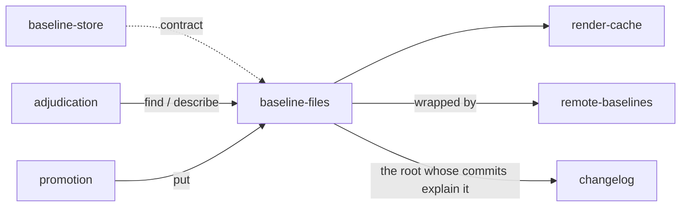

# Baseline files

«adapter»

## Responsibility

Keeps **baseline**s on a filesystem, at a path the operator's template renders
from what the subject is, whether the root is a directory the runner owns or a
tracked path that travels with a branch.

## Bounded context

[Identity and retention](../../DOMAIN.md#identity-and-retention)

## Inputs and outputs

In: a root, a path template, and the lookups and writes of
[`baseline-store`](../baseline-store/README.md). Out: an image and the sidecar
beside it, read as a **raster** once it has passed the record checks.

The image and its sidecar are a pair, and the pair is the unit. Bytes are not a
baseline: what makes them one is the **renderer identity** that painted them,
the dimensions, the fonts that were missing, the **digest** of the document they
came from, and the **component hash**es that document rendered. The sidecar
stays text, so the half of the artifact a person can review stays reviewable.

The path is the operator's, and it is the reviewer's interface: a committed
baseline is reviewed as a file in a pull request, so its path names the subject
and nothing a person cannot check. A template renders it from the key — the
file that declares the subject, its title, its name, its id, the Playwright
project that observed it — and from the engine's family, never from a digest. The default files a subject under its
title in one parallel tree; a template that starts at the declaring file's
directory puts the image beside the code, in the same review, the same move and
the same delete. Renderer identity lives in the sidecar, so two machines on one
engine write one file, the last accept is the baseline, and the other machine's
comparison names the identity field that moved as its cause.

Where the root is a tracked path, images go through a large-file filter and the
sidecars do not. The bytes stay ordinary files — a checked-out tree
already holds the real image at the real path, and routing reads through the
version-control tool would add a second way to obtain the same bytes and
therefore a way for the two to disagree. What the tool is consulted for is
whether the glob is genuinely routed through the filter, and its absence
degrades to a diagnostic rather than a failed run.

## Depends on

- [`baseline-store`](../baseline-store/README.md) — the contract, the refusal,
  and the checks a stored record passes before it is believed
- [`render-cache`](../render-cache/README.md) — supplied by every backend, and
  given a root of its own where the baseline root is one somebody commits

## Used by

- [`remote-baselines`](../remote-baselines/README.md) — what the serving half
  wraps, so remote means durable, further away
- [`promotion`](../promotion/README.md) — the pairing a promoted candidate is written in
- [`changelog`](../changelog/README.md) — the root whose commits are read for the explanation
- [`adjudication`](../../adjudication/README.md) — the default place a
  comparison's other side comes from

## Boundary

The path is never evidence. Whether a baseline is comparable is decided by the
record beside it: an image painted under another identity is still read, and
the identity field that differs is named as the cause, so a runner upgrade is
one sentence rather than a day of red nobody can attribute. The lookup tries
this engine's path first, then the other engines' files at the same path, so a
wrong-engine run says what it *did* find.

Two subjects that render one path are a collision, and a collision stops the
run naming both subjects — on the keys a run declares before it observes, and
again on every lookup and write. The sidecar names the key it was placed for,
so the refusal reaches a shard, a worker or a later run that never saw the
other key, and it names the token that tells the two apart. Nothing is renumbered, because a renumbered path is a name that
depends on plan order. The comparison folds case, since a case-insensitive
checkout would merge the two files.

Baselines written under the identity-directory layout are still read: a lookup
that misses the template's path finds them, reports the subject `relocated`
with both paths, and a write puts the pair at the template's path and removes
the old one, so the pull request that accepts it shows a rename.

The path decision exists once. The branch-carried backend reimplements none of
it and delegates every one, because a second copy of the template is a second
place for two backends to disagree about where a baseline is.

The cheap answer reads the sidecar and stats the image, written out rather than
expressed in terms of the full lookup — *in terms of the full lookup* is exactly
the megabyte it exists not to spend. It hands on component *names* and never
hashes: a name can only answer membership, and membership is the only question
selection is allowed to ask.

A pointer file where an image should be is fetched with `git lfs pull
--include` when `find` reads it, and refused by name when the fetch fails. It is
what a clone without the smudge holds, it is not a baseline, and comparing a
subject against it would be comparing a subject against a text file.

## Implementation coordinates

`packages/store/src/durable.ts` — `createDurableStore` and the lookup order;
`packages/store/src/claims.ts` — the collision claim, in one store and through
the sidecar's `placedFor`; `packages/store/src/path-template.ts` — `parseBaselinePath`,
`DEFAULT_BASELINE_PATH`, and the token rules; `packages/store/src/legacy.ts` —
`legacyHolders`, where an identity-directory baseline is read from;
`packages/store/src/pair.ts` — reading and retiring an image and its sidecar;
`packages/store/src/lfs.ts` — `createLfsStore`, the pointer refusal, and the
injectable command runner that separates *this is not a repository* from *this
machine has no such tool*; `packages/store/src/lfs-tracking.ts` — what git
resolves for a tracked path, and whether git-lfs is installed and set up to run;
`packages/store/src/lfs-fetch.ts` — the reader that fetches a pointer's image,
one pull at a time.

## Diagram

