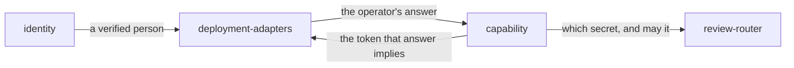

# Capability

«policy»

## Responsibility

Decides which declared credential a caller presented — ingest, review, or the
optional share token — and whether that **capability** may do what the
chosen route requires. The share token reads a share and what review settled,
and never writes or decides.

## Bounded context

[Review](../../DOMAIN.md#review)

## Inputs and outputs

In: the credential on a request, and what the deployment declared. Out: a
principal: one of three capabilities, or nothing at all, and the name the
credential proved when it proved one.

At construction it reads the declaration and refuses the deployment outright:
nothing declared, a declared mechanism missing its values, a value committed for
a mechanism not declared, or a token under sixteen characters.

## Depends on

An issuer's published keys, fetched to verify a signed token, and nothing else. It
is structural about its inputs, seeing the declaration and not the deployment's
project or its retention window, so that authentication cannot be made to depend
on either by a later edit.

## Used by

- [`review-router`](../review-router/README.md) — the check before parsing, and
  the check after routing
- [`deployment-adapters`](../deployment-adapters/README.md) — the
  the declared policy each host hands the handler

## Boundary

It proves no names. A principal carries the name a mechanism proved, and producing
it is [`identity`](../identity/README.md)'s job. A machine ingests and does not
decide, so a request with no proven name reaches no deciding route.

It ships no default policy for a hosted mount. Returning the deciding capability
for every request would publish an approve button to the internet, and a library
that shipped that as a convenience would be shipping the failure — an operator
who genuinely wants an open surface writes it themselves, in their own file,
where the next person reading that repository can see it.

## Implementation coordinates

- `packages/tribunal/src/worker-auth.ts` — `grant` decides which secret was
  presented; `refuseWeakTokens` is the construction-time refusal;
  `requires` is the after-routing check; `readable` admits ingest and review to
  history reads; `attested` admits review and share to what review settled and
  refuses ingest; `sharable` admits ingest to a share and share to reading it;
  `UNAUTHENTICATED` is the one sentence a caller holding no token ever gets
- `packages/tribunal/src/worker-attested.ts` — the read-only review routes,
  the changelog and the decision history, each checked by `attested` before
  its method
- `packages/tribunal/src/policy.ts` — `declaredPolicy`, the policy every shipped
  deployment runs
- `packages/tribunal/src/next.ts` — `createTribunalRoutes`, which strips the mount's
  prefix and leaves the policy to the handler
- `packages/tribunal/src/node/serve.ts` — the same requirement on a socket, over
  the same mount
- `packages/tribunal/src/policy.ts` — `declaration` and `declaredPolicy`, the one
  reading every host makes of what a deployer declared
- `packages/tribunal/src/node/bin.ts` — the defaults for a process on a machine
  somebody owns
- `tribunal-cloudflare/app/tribunal.ts` — the deployed console, on the same
  declared policy

## Diagram

