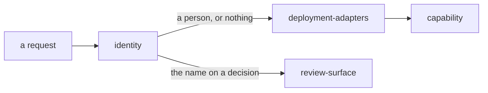

# Identity

«gateway»

## Responsibility

Establishes that a request comes from a named person, so that a decision made
through the surface can carry a name.

## Bounded context

[Review](../../DOMAIN.md#review)

## Inputs and outputs

In: a request, and the deployment's identity configuration. Out: a name, or
nothing — and nothing means the surface is not drawn.

On a network deployment the assertion is a signed token, taken from the header or
the cookie a browser navigation carries, and verified against the provider's
published keys — including the audience, compared against this application's own
tag, so a token minted for a neighbouring application in the same team is
refused. A settable header is never trusted, because an origin reachable beside
its gate turns that header into a request header like any other.

A credential that rides along by itself proves nothing about who sent the write:
a write a browser carried here from another origin never reaches a policy,
declared or a host's own, whatever cookie came with it. `SameSite=Lax` on a cookie is a second guard behind
that refusal.

## Depends on

Nothing in this block. It reads the request and the deployment's configuration.

## Used by

- [`deployment-adapters`](../deployment-adapters/README.md) — the answer that
  becomes a reviewing **capability**
- [`review-surface`](../review-surface/README.md) — the name written on every decision

## Boundary

It authenticates a person and never a machine. A credential that authenticates a
machine carries no name, and a token holder is refused here rather than given
one: a rendered review surface has to put a reviewer's name on a decision, and a
capability has none to give.

It holds no accounts. Absent configuration is refusal, never a
default — with no configured identity source, nothing can tell one visitor from
another, and the approve button stays undrawn rather than falling back to
anonymous. A deployment that declares `VIEW=public` serves an anonymous reader,
because its evidence is public by the deployer's say; that visitor still has no
name, so nothing they send can decide.

A person arrives through GitHub sign-in or Cloudflare Access, whichever the
deployment declared, and the name is the login or the email that source proved.

On a loopback bind it asserts nothing and takes the operator's word: anything
that can open a loopback socket is already running as the person who started the
process, and asking them to paste their own secret back to themselves buys
nothing. On a bind reachable from off the machine the surface is not served at
all — there would be nothing between an approve button and the internet.

## Implementation coordinates

- `packages/tribunal/src/issuer.ts` — the one verifier of a signed token, its
  per-isolate key cache and the refetch on an unknown `kid`
- `packages/tribunal/src/github-signin.ts` — the GitHub sign-in, the write check
  and the signed session
- `packages/tribunal/src/policy.ts` — `declaredPolicy`, which answers a principal
  from what the deployment declared, and `LOOPBACK`
- `packages/tribunal/src/worker-auth.ts` — `introduced`, the `/auth/me` answer a
  page asks on load, because who is asking is a per-request fact
- `packages/tribunal/src/node/bin.ts` — `TRUST_NETWORK_VARIABLE`, and `REVIEWER_VARIABLE`, which defaults to the user
  running the process
- `packages/tribunal/src/node/serve.ts` — `reviewer`, carried into the served page

## Diagram

