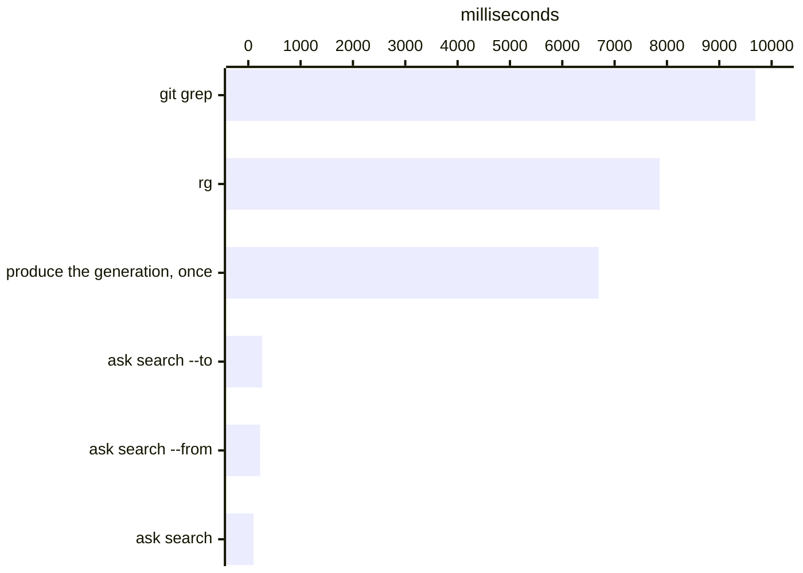
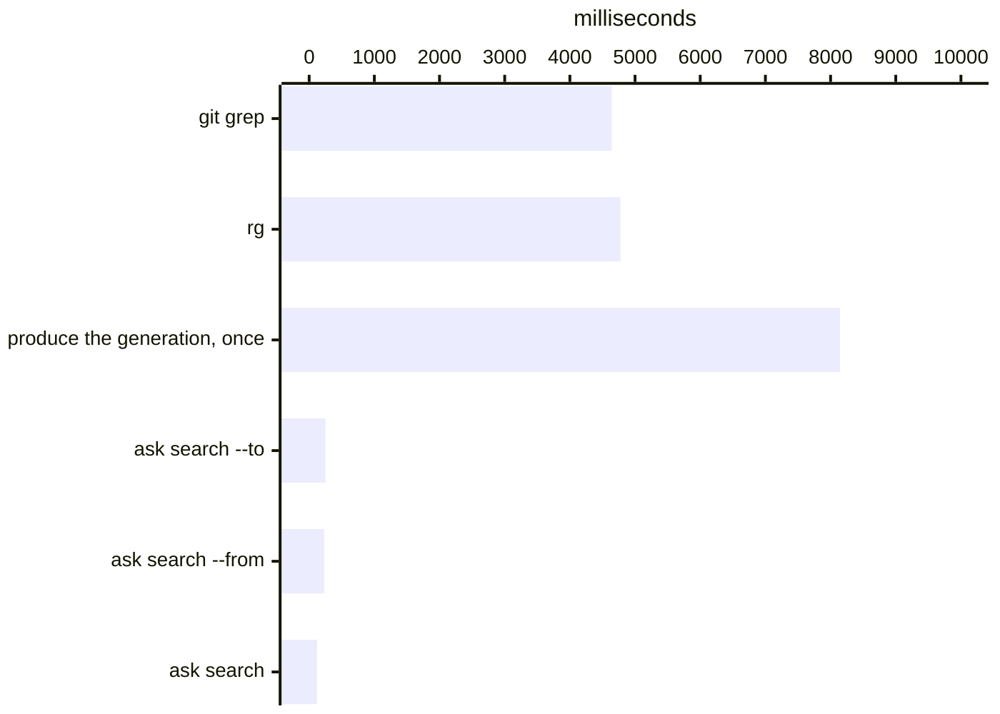

# Find code through the workspace index

`rg` tells you where text is written. This server tells you which name matches
your words in the part of the import graph you are working in — an exported name
first, then one a file keeps to itself — then gives you its declaration,
signature and documentation, and for an exported name its import line and
existing import sites. It answers from a dated workspace generation — no build,
run, generated API site, or `variance.config.json` in between.

This is the source how-to and contract for
[orientation](orientation.md). Start there when you need to choose between text
search, indexed source search and observed-subject search.

The difference matters when a checkout is too large to open again for every
question. A [source index](source-index.md) parses and resolves a file once,
stores its exported names and outgoing edges, and reuses that record while the
file and its resolution inputs stay the same. A question with `from` or `to`
then filters names through those stored edges instead of searching every file
for another string.

## Choose the cheapest entrance

| You need | Start with |
| --- | --- |
| An exact string in arbitrary file contents | `rg`; it needs no index and reads the working tree now. |
| An exact string in committed source | `git grep <tree>`; a named tree searches Git objects and deliberately leaves working-tree edits out. |
| A name you can only describe, its exact signature, or the code that imports it | This server; those answers depend on declarations, exports, resolved imports, and the area named by `from` or `to`. |
| Nothing in hand, and the repository unknown | `docs_orient` with no `files`; it prints the code map, the repository's packages in areas, and `area` opens one area. |
| Files in hand, and the code around them unknown | `docs_orient`; it names each file's package, names crossing its package boundary, external packages requested along its local imports, the separately refreshed installed API of those imports when present, the recorded tests that ran it, and the calls those tests took into and out of it. It finds no file itself. |

## Search finds the name; the graph finds the area

The workspace generation combines two different answers. Names and documentation
find a candidate such as `createStore`. Resolved import edges decide whether that
candidate belongs to the code in question.

Carry a path into the first search whenever you have one:

```bash
variance ask search --query createStore --from src/fulfilment/ --just-answer
```

`--from` walks along imports and keeps names used inside that closure. Use
`--to` when the known thing is a dependency or helper and the question is what
depends on it. Both walks have no depth limit. This turns a common word that
matches hundreds of files into a relation question over the area the path
actually connects to.

Once the search returns the name, ask `symbol` for its contract and `uses` for
its exact import sites. `uses --from` only orders those sites by path proximity;
it does not perform another graph traversal or remove any result.

`variance index` publishes a separate catalogue of installed third-party APIs.
`ask search` shows those names in their own section, after the repository's
own. A `--from` or `--to` path
limits them to packages available to the workspaces in that graph closure; the
answer labels imports separately from availability. Ask `symbol --name <name>
--package <package>` for the installed signature and full documentation. The
declaration provider is named when it differs from the runtime package. A
package the workspace resolves but that ships no declarations has no names to
match, so `symbol` reports that, gives the path and line count of the
`README.md` beside its manifest, and quotes the README passage that names the
symbol, labelled as that file's. Naming `--package` reports the README even when
it does not mention the symbol; a package with no README is reported as shipping
none.

The packages a file can already use, and the agent skills those packages ship,
are on [their own page](tech-stack.md).

This is a resolved module graph, not a function-call graph. It records file
imports, re-exports, literal dynamic imports, type imports, asset edges, and the
files a module names in `/// <depends path="…" />`. It can answer what a file
rests on, what rests on that file, and where an exported name is imported. A
member of an interface, a type literal or a class is never imported: `uses`
names where a member by that name is declared, after any imports, and under
each declaration the lines that call, read, write or destructure it through a
value whose type the line writes, joined to that declaration through the import that
binds the type's name, and the members of the classes that write `implements`
of that declaration. A line whose value's type a checker would infer, a JSX
attribute, or an object that implements the member with no type on its line,
such as one passed as `deps:`, is not in that list, and the answer ends by saying so and naming the
declaration's `file:line`, or with several declarations the one you
pick from its list, for
find-references and go-to-implementation in that language's tooling, TypeScript's language
service for JavaScript and TypeScript, which lists those uses and implementations. Members are read
from JavaScript and TypeScript files only, so a Python class's methods and a
Rust struct's fields and `impl` methods are not; top-level declarations are read in
every language the index reads, Python, Rust, Java, Kotlin and Swift
included, and a function or an arrow function declared inside another
function's body is read in JavaScript and TypeScript and answered with the
function that holds it. `ask symbol` answers a top-level declaration of the
name first, in any of those languages; on a name that no top-level declaration
or import has, it names each container that declares it as a member, with the
member's `file:line`, beside any function that declares it inside its body, and
points to `uses`, which lists the members beside any top-level
declaration. When the workspace also holds Python, Rust, Java, Kotlin or Swift
files, an answer that looked for members ends with a sentence that names those
languages, whether or not it found one, and sends you to their language
server's workspace symbols. The graph does not record that one
function called another at runtime; open the named file or use a language
server for that question.

No graph database service sits on the answer path. The producer publishes a
compact graph beside the names and materializes both directions, so walking
dependencies and dependents are the same bounded operation over the recorded
generation. The graph is the relationship data; its storage is not another
service an adopter has to operate.

Text search remains the shorter route when text is the answer. It has to scan
content again for the next word, and it does not resolve the imports it finds.
The workspace producer pays for parsing and resolution, then publishes an
answerable generation outside the checkout. The question path reads that value
without scanning the repository again. Producing and answering are separate operations:
a CI step can publish once, then every agent in that step can ask the same dated
facts without making freshness checks part of query latency.

This path is measured on two public repositories. The first is seven copies of
[Material UI](https://github.com/mui/material-ui) side by side in one checkout:
288,197 tracked paths. The second is [Kibana](https://github.com/elastic/kibana)
at `df0daaddcc`: 125,804 tracked paths in 1,488 packages, each declared in a
`kibana.jsonc`. Every figure is the median of seven runs, each run a separate
process looking for `button`, on an Apple M4 Max with 64 GB, macOS 27.0, Node
v26.7.0, ripgrep 15.2.0 and a warm filesystem cache. The first chart is seven
Material UIs and the second is Kibana, on the same scale:





| One process | Seven Material UIs, ms | Kibana, ms |
| --- | --- | --- |
| `git grep -niF button` | 9,688 | 4,643 |
| `rg -niF button .` | 7,862 | 4,777 |
| produce the generation into an empty index, once | 6,695 | 8,144 |
| `variance ask search --query button --to` a shared button | 263 | 250 |
| `variance ask search --query button --from` an input with suggestions | 228 | 230 |
| `variance ask search --query button` | 101 | 122 |

Each start point is one file. `--to` names a shared button: `…/ButtonBase.js`
in Material UI, and
`src/platform/packages/shared/shared-ux/button_toolbar/src/buttons/toolbar_button/toolbar_button.tsx`
in Kibana. `--from` names an input that offers suggestions as you type:
`…/Autocomplete.js`, and Kibana's KQL query input,
`src/platform/plugins/shared/kql/public/components/query_string_input/query_string_input.tsx`.

The text searches pay their whole cost again for the next word, and they return
every file that contains the string: on Kibana, `git grep` prints 115,305 lines
from 12,577 files. The producer pays once, and every question after it reads the
published generation. On seven Material UIs, producing costs less than one text
search. On Kibana, with less than half the paths, the text searches take
4,643 ms and 4,777 ms, against 9,688 and 7,862, and producing takes 8,144 ms,
against 6,695. That is less than two text searches, so from the second question
on, producing once and asking costs less than searching the text for each one.
The producer on Kibana peaks at 2,702 MiB of resident memory, against 2,402 MiB
on seven Material UIs.

A question without a path costs about 100 ms at 2,500 paths, at 41,000 and at
288,000: it opens a search file the producer publishes beside the generation and
decodes only the rows it prints, so nearly all of that 100 ms is Node starting.
In the session that measured Kibana, `variance ask` with no question, which
reads no index, takes 108 ms, so the search itself costs about 14 ms.

`--from` and `--to` also load the import graph and walk it. The walks from
Kibana's start points cover more files than those from Material UI's, and take
about the same time: 36,108 files import Kibana's shared button, directly or
through other files, against 25,271 for `…/ButtonBase.js`, and its KQL input
imports 4,927 files the same way, against 788 for `…/Autocomplete.js`.
`--from` is reachability at any depth, not a maximum hop count; the answer
prints import distances where it has them.

`git grep` and `rg` read the text in different ways: `git grep` can read packed
objects, and `rg` opens each file in parallel.
[Then stop opening the file](performance.md#then-stop-opening-the-file) measures
that difference, and [after the first read](performance.md#after-the-first-read-you-do-not-read-it-again)
measures what a scan costs on a public checkout with no index, unchanged, and
with a few files edited. The index adds the facts
that neither read supplies — declarations and resolved relations — and keeps
them for the next question.

Ordinary source questions reuse a generation for one hour, then refresh it.
Without `--just-answer`, a source question other than `search` that a reused
generation refuses is asked again, whether you ask through `variance ask`,
`variance serve` or `variance-authority-help` and its server: the name is
looked for again in a generation made from the checkout as it is, and in what
your installed packages export, with that list built first when it is missing
or behind. A function you wrote a minute ago, or a package you just installed,
is answered rather than reported missing, and that holds when you name changed
files too. Only a refusal pays for that reading; an answer that found its name
comes from the generation it was found in. When the checkout cannot be read
again, the refusal names the generation time, says the checkout was not
compared with it, and says why. When the list of installed exports cannot be
built, the refusal says the installed packages were not compared, and why.

Pass `--just-answer` when the caller owns freshness: no Git status, generation,
or regeneration is performed, and every answer and refusal names the generation
time and says the checkout was not compared with it; as JSON, `search` carries
`compared: false` beside `generatedAt`. If no generation has been published,
the command refuses instead of silently turning the question into production
work.

When no changed files are named and a search is published, `search` opens it
at any age, because in CI the step before it already brought the index up to
date and is the one that owns freshness. The answer says, as one under
`--just-answer` does, that the checkout was not compared. With no published
generation, `search` reads the checkout and publishes the search, the way any
other question does, and that answer is the checkout's. Under `--just-answer`
it refuses instead, says the flag is why, and names the command to run.

When an editor, watcher, or orchestrator produces a generation and already has
the changed paths, write their scan-root-relative paths to a newline-delimited
file and pass that file through `--changed-file`. An empty file declares that
nothing changed. This is producer input: it replaces Git's changed-file
discovery and cannot be combined with `--just-answer`. [Naming what
changed](source-index.md#naming-what-changed) gives the file contract.

## Point the server at the workspace

Use Node 22 or newer. Install the package in the TypeScript workspace:

```bash
npm install --save-dev @variance-authority/help
```

The package installs a `variance-authority-help` binary, which answers the same
questions on the command line, with no client and no server:

```bash
npx @variance-authority/help search viewport --root .
```

Pass the package name to `npx`, not the binary name: `variance-authority-help`
is not a package name and the registry will report it missing. `--root` is the
workspace to read; omit it when you are standing in that workspace.

A workspace that already has `@variance-authority/cli` installed needs neither
this package nor its binary, over either transport. The same questions are on
`variance ask`, beside the questions about a run, and read the checkout under
the working directory:

```bash
npx variance ask search --query viewport
npx variance ask symbol --name Viewport
npx variance ask search --query viewport --from packages/app/ --just-answer
```

The flags are the tool arguments, spelled `--name`, `--package`, `--subpath`,
`--query`, `--from`, `--to` and `--limit`; `--just-answer` selects the last published
generation. An answer names a flag or a next question the same way —
`--from`, `variance ask symbol` — where the tool over MCP says `from` and
`docs_symbol`. [Ask about the code and its runs from the
command line](agent-cli.md#find-a-name-in-the-source) shows each one.

The source questions are also tools on `variance serve`, under the same names as below, so
a workspace with the CLI declares one server for the run and the source
together. The rest of this page is that contract, whichever of the two serves
it.

Without the CLI, configure the MCP client to launch this package's server with
the workspace root:

```json
{
  "mcpServers": {
    "workspace-api": {
      "command": "variance-authority-help",
      "args": ["."]
    }
  }
}
```

Here `.` is the server process's working directory. Pass the workspace's
absolute path when the MCP client launches outside it. The configured command
must resolve the installed package binary.

## Read from entrypoint to symbol

Call `docs_packages` first. It counts and lists no import site. A row in its
first block is a specifier, what one import line names, with the names it
opens. An indented row is a package other packages import files of: by path,
when the package declares no entry, or past the entry it declares, a deep
import. A package whose declared entry the reading could not follow to a source
file, such as a build output the checkout does not hold, opens no names, and
the imports that name that entry are counted apart from the deep ones. Either
row goes to `docs_entrypoint` as `package`, exactly as printed.

Called with a specifier, `docs_entrypoint` lists the names it opens, ranked by
how many workspace packages import them. Called with a package's name, it lists
the names its main entry opens and then counts the imports past that entry, one
row per file, the file the most files import first; for a package that declares
no entry it counts the imports of its files by path the same way. Each row is a
specifier, and called with it, `docs_entrypoint` counts the imports written as
that specifier per name, each with how many files import it; `docs_uses` with
the name and the specifier lists their files and lines. Then call `docs_symbol`
for the import line, declaration, signature, source documentation, and
importing packages of the name you are investigating.

Call `docs_uses` when the question is how the name is written here rather than
what it is. It returns the file and line of every import, with the
stories and the tests — the files written to show the name in use — listed apart
from the source that depends on it. Pass `from` with the file you are editing and
the sites arrive ordered by how many leading path segments they share with it.
Each kind of site, and each list after the imports, shows twelve and counts the
rest; pass `limit` to show more.

`docs_uses` lists the imports within the name's own package too, counted and
listed apart from the ones from other packages: every import
that resolved to the file declaring it, or to a file that passes it on with
`export … from`. Each import that binds a name ends with the lines its file uses it on. That file is followed under the name it exports and is not
listed itself, in another package as well, so an import through a barrel is
counted once. A site that knows the name by another one is marked with it,
`(as salute)`: an import that renames it with `as`, or an import of a re-export
that renamed it.

A renamed import is followed in both directions by the binding the parser read,
never by how the two names are spelled. `docs_symbol` for the original names
every file and line that imports it under another name. `docs_symbol` for the
local name, `hail` in `import { greet as hail } from './greet.js'`, answers
with that import and then with `greet`: its declaration and import line when an
entry publishes it, the file and line that export it when none does, or the
installed declaration when the specifier names a dependency. An original the
file only passes on with `export … from` is followed to the declaration it
reaches, and an interface, a type alias or a class lists its members, as when
you ask for the original by its own name.

A name a file exports and no entry publishes, such as a helper exported for the
file beside it, is answered too. `docs_symbol` gives the file and line that
export it and how many imports reach that file, directly or through a file that
passes it on; `docs_uses` lists those imports, from its own package as well as
from others. When that file only passes on another file's declaration with
`export … from`, renamed, type-only or through `export *`, both name the
declaration it reaches, through every file between, and `docs_symbol` shows its
line as well. A name a file passes on inside `export * as ns`, or inside
`export { ns }` after `import * as ns`, is counted where you read it off `ns`, `ns.name` or `const { name } = ns`, through a namespace
inside a namespace, `lib.ns.name`, `const { ns } = lib` and then `ns.name`, or
`const { ns: { name } } = lib`, and through a namespace passed on as
`default`. An entry that publishes the name only inside such a namespace
publishes it as `ns.name`, and the first line says so: `published as
\`shout.greet\` by @acme/lib`. A namespace imported by name that goes
somewhere whole and, outside Rust, a call through a qualified path are not
counted.

`docs_symbol` on an interface, a type alias or a class lists its members after
the signature, one line each as the checkout holds it, so you see what a value
of it holds without opening the file.

A name a file declares and does not export, such as a helper only its own file
calls, is answered from the source index. Not exported means no export of a
JavaScript or TypeScript file names it, a Rust item at the top of the file is
not `pub` or is `pub(self)`, a Rust item inside an inline module is not `pub`
or sits in a module that is not, a Swift declaration is `private` or
`fileprivate`, a Kotlin one is `private`, or a Python name has a leading
underscore or is left out of `__all__`. A `pub` Rust item whose inline modules
are all `pub` is not declared on its own: the file exports the outermost of
them, and you ask for that module by name. `docs_symbol` gives its kind, the
file and line that declare it, its signature, what is written above it, and who
can reach it under the file's language, after any export of the same name in
another file. A name
in a JavaScript or TypeScript module, a Swift `private` or `fileprivate` one
and a Kotlin `private` one are that file's alone: no other file can import
them. Another Python module can still import the name by spelling it. A Rust
item is named only by its module and the modules inside it. A Rust item inside
an inline module, such as a helper in `mod tests`, is declared on its module
path inside the file, `tests::helper`, and answers to that path or to its own
name. A `macro_rules!` inside one keeps its own name, because a macro has no
module path. If it is not `pub`, the same rule names who can reach it: `tests` and the
modules inside it. If it is `pub`, the modules around it decide how far it is
seen, so the answer says who can reach it is not recorded. CommonJS is read on
a best-effort basis: the static keys of an object literal that `export =` or
`module.exports =` assigns at the top level are the file's exports, and naming
a declaration there passes it on, which is no use of it. An object with a
spread or a computed key with no literal name exports nothing, because its
names cannot be spelled.
A script or CommonJS file, a module that hands itself out with `export =` and
a `macro_rules!` hand a name out in ways their readers cannot tell, so the
answer says who can reach it is not recorded. `docs_uses`
answers with the same kind, file, line and rule in one sentence, before any member
declared by that name, and after the imports of an export of that name elsewhere.
The kind tells apart two declarations that share a spelling: a Rust `mod walk;`
is answered as a `[module]`, and the imports listed above it belong to the
`fn walk` the module exports.
It lists the imports the source index resolved to the declaring file: for a
Rust item the modules inside its own that name it, by a `use` or by a path
written in a type or an expression, such as `super::flag()`, and for a Python
name the modules that import it, with the `ask grep` that finds the ones
spelling it some other way. Each answer names the files whose
declarations were not read, such as one over the size a read opens, since the
name may be declared there. `docs_search` lists the name after the exported ones, under a heading that
says it is not exported, when the name or its documentation holds the query, and
only when its file is in the area `from` or `to` names.

The file that declares a name uses it without importing it, so `docs_uses` lists
those lines too, after the imports, under `Used in <file>, which declares it`,
one heading for each file that declares it:
a call, a read, a type, a Rust `self::name` path or a test module's
`use super::*`, in a TypeScript, JavaScript or Rust file, for a name it exports
and for one it keeps. The lines follow the language's scope, so a parameter, a
local or an inner item of the same name is another name and is not listed, and
neither is the declaration. A Python, Swift, Java or Kotlin file is answered by
its imports alone.

Each file that declares a name declares another thing, so `docs_uses` answers
for every one of them, each kept apart: under the line naming each file that
exports the name without publishing it come that declaration's own imports, as
the uses of a kept one come under its own heading. Pass `file`, the file one of
them is declared in, to answer for that declaration alone: `variance ask uses
--name greet --file packages/lib/src/greet.ts`. A `file` that only passes the
name on with `export … from` answers for the declaration it reaches, and a
`file` that declares nothing by the name is answered with the files that do.

A name your code reads off a namespace or default import, written with
`import type` or without, or off `import()`, is a site too, and the site names the line that loads the module. In a
type, `typeof ns.x` and `ns.T` read `x` and `T` off whatever holds the module. An `import()` loads it when that call
runs, not when the file loads, so the file can run without the module ever
loading. An `import()` written in a type, `import('./x').T` or
`typeof import('./x')`, loads nothing: TypeScript resolves it as it resolves
`import type`, so its site is marked type only. `typeof import('./x')` names
the module's type and reads no name of it. A value that type is written on — a
cast, or an annotated variable or parameter, directly or through a top-level
alias — holds the module, and a name read off that value is a type-only site,
as `M['x']` off the module type `M` is. What a call returns is TypeScript's
answer, and the reader does not work it out: a name read off the value
`await importOriginal<typeof import('./x')>()` returns is not listed, because
the reader cannot tell which module the value came from, not because the line
reads no name. A name read off the module's
`default` is marked "through `default`": `default` holds the name only when the
module is CommonJS, so the line may read it and is counted apart from the
imports. A module your code hands to a function the same file declares, as
`count(lib)` with `function count(held)`, is followed into that function, and
what it reads off the parameter is what the line reads, not a type-only read,
whatever the parameter's type says. A parameter the function writes to is not
followed. A module that goes on
whole anywhere else — to a call the file does not declare, a property or a
return — may read any name it exports, because what the receiver reads is out
of the file's sight. It is listed as a site that may
read the name, marked "passed on whole", and counted apart too. Neither is an
import of the name, so neither makes a name look used, and a name with only
these is unknown rather than unused: the catalogue says where it may be read.

`docs_uses` answers who depends on a declaration of this workspace. For a name
no file here declares that your code imports from a package outside the
workspace or a runtime module, whether or not it is installed, such as `parseSync` from `oxc-parser`, it names each package or
module the name is imported from and the next question to ask: `variance ask
discover --imports oxc-parser#parseSync`, run in the checkout, lists every file
that imports `parseSync` from `oxc-parser`, with the line of each import. The
server holds no scan of the names your files import, so `docs_discover` refuses
that question.

An import whose specifier the source index resolved to no file, such as
`./gone.js` after the file was moved, is not read, so a use behind it is not
listed. When such an import could take the name, because it is relative or
names the package that declares the name, the answer names each file that
holds one, the first three and a count of the rest. Fix the specifier, or read
those files for the name.

Open those files yourself. The server names the place and the line; it does not
serve the text, so what you read is the file as it is now.

Use `docs_search` only when the name is unknown: it performs a
case-insensitive substring match over names and documentation, not semantic
ranking. Several words also match a name written in those words, in any order,
so `kept reading` finds `keptReading` in that answer. Where your words land on a
name only loosely — a word typed wrong, or two words its documentation writes
but not beside each other — those names follow under a heading of their own,
after that answer and never inside it. So do the names holding any of your
words, matched by stem, the ones holding most of them first, each labelled with
the words it holds; both come
before any installed package.

## Bound a search to where you are working

A substring matches everywhere a large repository writes a common word. Pass a
start point and `docs_search` answers only from one part of the checkout:

```text
docs_search  query: order  from: src/fulfilment/
```

`from` answers from the files that path reaches along the imports, at any
depth. `to` answers from the files that reach it — use it when you start from a
helper and want the screens or other dependents behind it. Pass both and you get both
areas together; they are combined, not intersected, because two entry points of
one application usually share no file.

A start point is a path in the source tree, said at one of three widths —
`src/a/File.ts`, `src/a/*`, `src/a/` — and a path the checkout does not contain
is refused by name; you never receive an unscoped answer under a scoped
heading. [Say where to look](locate.md#say-where-to-look) is the rule in full,
and it is the same rule here: one path vocabulary, read by one resolver,
whichever question names a path.

Scoping removes names rather than ranking them down. An empty answer with a
start point is a fact about that area, and the answer reports how many files it
searched. Ask again without `from` and `to` to search the whole workspace.

The same start points are available from the shell, under whichever binary you
have:

```bash
variance ask search --query order --from src/fulfilment/
variance-authority-help search order --from src/fulfilment/
```

## What the answer shows, and what it does not

The server reads manifests and source, not `dist`. It parses JavaScript and
TypeScript with `oxc-parser` and resolves with `oxc-resolver`; no TypeScript
language service runs behind it. Rust, Python, Swift, Java and Kotlin files are
read with tree-sitter grammars, for their imports and their top-level
declarations, and Rust files also for the declarations inside inline modules. A types target under an output directory is mapped back to that
package's source. A consumer is a workspace package whose source imports the
symbol; it is not a claim about runtime execution or external adoption. For a
top-level name, a site in another file is an import of the name, or a read of
it off a module the file holds whole, not a call to it: where that file uses a
named import is a question for your editor's language server. A member has no
import, so its sites are the typed lines described
[above](#search-finds-the-name-the-graph-finds-the-area).

Missing documentation remains missing, and a search with no exact substring
match reports that before it offers anything near it. Those absences are source
facts, not prompts for the server to infer an answer: a looser reading of your
own words can add names below the answer, and nothing can promote one into it.

Where nothing is written above a declaration, the server may quote the nearest
`README.md` that names the symbol, labelled with the file and line it came from.
Read it as prose written about a package, not as a description of the signature
above it: the name still counts as undocumented by `docs_gaps`, the
call that lists names other packages import with nothing written above the
declaration.

`from` means two different things across the two tools, so read each one for
what it does:

- **On `docs_uses`, it orders and never removes.** Every site of the name still
  comes back, and proximity there is shared path segments, a fact about the
  filesystem.
- **On `docs_search`, it is a start point.** The import graph is walked and
  names outside the closure are removed.

Neither is a distance. How many hops separate two modules, and what selecting on
that distance costs, is [`@variance-authority/sense`](distance.md).

## Point an agent at it

Your agent reads `AGENTS.md` at the start of every session, and a skill only
when its description matches the task. Put these lines in `AGENTS.md`, with
`npx` changed to however your package manager runs a local binary:

```markdown
## Finding your way in the code

Ask before you grep: `npx variance ask uses --name <name>` lists who imports a
name, `ask symbol --name <name>` prints what it is and where it is declared, and
`ask search --query <words>` finds a name by what it does. The
`variance-authority` skill has the rest.
```

The skill is `variance-authority`. It ships in `@variance-authority/cli` at
`node_modules/@variance-authority/cli/skills/variance-authority` and covers the
rest of the CLI too. Claude Code reads skills from `.claude/skills`; most other
agents read `.agents/skills`. Link the skill into both rather than copying it,
so it follows every update:

```bash
mkdir -p .agents/skills && ln -s ../../node_modules/@variance-authority/cli/skills/variance-authority .agents/skills/variance-authority
mkdir -p .claude/skills && ln -s ../../.agents/skills/variance-authority .claude/skills/variance-authority
```

`variance doctor` reports whether your agent can find it.

The full tool and source-reading contract is in the
[`@variance-authority/help` package
reference](https://variance-authority.dev/reference/packages/help). When the
answer raises an ownership or entrypoint question, continue with [package
boundaries and public contracts](architecture.md#packages).
