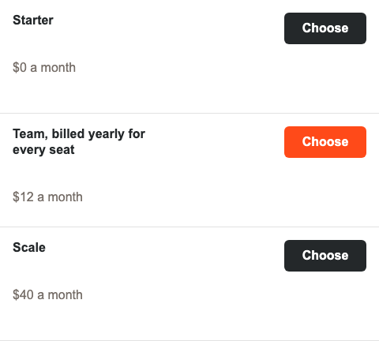
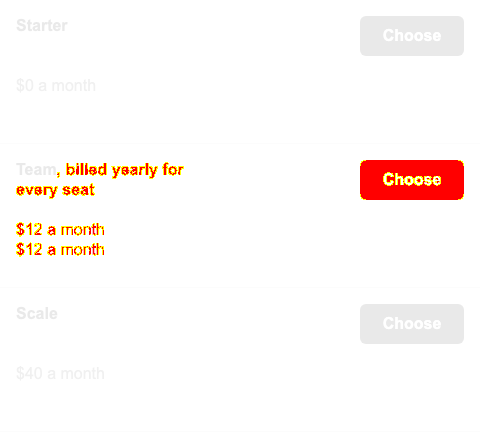

# Visual-review example

This directory is the executable source of the excerpts on
[Review a visual change](../../docs/path-visual-review.md). Three pricing cards
render in one list. In the second, the plan's name grows from `Team` to
`Team, billed yearly for every seat` and wraps onto a second line, and its
`Choose` button turns from charcoal to orange. Nothing else is edited: the
price below the name moves only because the name grew.

The run tells the three apart. The button changed **colour**, the name changed
**shape**, and the price is **displaced** — its pixels moved, but its own props
did not cause it. Each region is placed on its landmark path in the page and on
the line its component is declared at.

## What it produces

Running it regenerates the five files in [`artifacts/`](artifacts), all of which
are committed:

| before.png | after.png | diff.png |
| --- | --- | --- |
|  |  |  |

[`artifacts/report.txt`](artifacts/report.txt):

```text
pricing/plans: changed — 4,927 pixels differ across 3 regions in ChooseButton, PlanName, Price, 2 changed in shape and 1 only in colour
components whose hashes changed:
  ChooseButton · cause · token
  PlanName · cause · a11y, geometry, content
  Price · displaced · geometry
regions, causes first:
  ChooseButton · cause · colour · strong · 3670px · main → region "Plans" → list item 2 of 3 → button "Choose" · examples/visual-review-case/src/plans.js:53
  PlanName · cause · shape · strong · 733px · main → region "Plans" → list item 2 of 3 → heading "Team, billed yearly for every seat" · examples/visual-review-case/src/plans.js:30
  Price · displaced · shape · strong · 524px · main → region "Plans" → list item 2 of 3 · examples/visual-review-case/src/plans.js:42
```

The first line is the observation's own sentence. The rest is
[`scripts/run-case.mjs`](scripts/run-case.mjs) laying out the observation's
fields one per line, with nothing added:

| Report field | Where it comes from |
| --- | --- |
| `cause` or `displaced` | Whether the component is one of the observation's causes — its own inputs moved — or only sits where a cause pushed it. |
| `token`, `a11y`, `geometry`, `content` | The bands the component's hash moved in: a style value with the structure held, what a screen reader announces, its box, its text. |
| `colour` or `shape` | Whether the region's pixels changed only in colour, or in where ink is. |
| `strong` or `faint` | Whether the region's change grade reaches the strong threshold. |
| `Npx` | The pixels in the region that differ. |
| `main → …` | The region's landmark path, as a screen reader would reach it. |
| `plans.js:N` | The line the component is declared at. |

[`artifacts/provenance.json`](artifacts/provenance.json) records the engine that
painted the two PNGs, the platform it ran on, the components the run named as
causes, and the changed-pixel count the comparison finds between the two
committed PNGs. The counts are checked against those PNGs, not against a fresh
paint: the same engine rasterizes text differently on macOS and Linux.

## What it does not show

One run of one change. Every region here grades strong, so no `faint` line
appears; nothing in it is out of the run's sight, so no region reads
`unobserved`; and no component changed in the `texture` band. Those outputs
exist in the engine — [Attribution](../../docs/attribution.md#how-strongly-it-changed)
says when a region grades faint, [Sensitivity](../../docs/sensitivity.md) says
what `texture` is, and [Architecture](../../docs/architecture.md#the-contracts)
says when a band reads `unobserved` — but this
example does not produce them, so it does not show them.

## Run it

You need a checkout, `yarn install`, `yarn build` (the example imports the
workspace packages from their build output), and a Chromium binary from
`npx playwright install chromium`.

From the repository root:

```bash
yarn workspace @variance-authority/example-visual-review-case generate
```

It prints the report and rewrites the five files in `artifacts/`. The package is
private and is not published; `generate` is its only script.

The Vitest file re-runs the same comparison and checks it — the colour and shape
classes, the displaced price, the bands, the landmark paths — and that the
committed report, apart from its pixel counts, is the one the run prints. The
pixel counts are checked against the committed PNGs, and the documentation's
quoted lines against the committed report. From the repository root:

```bash
yarn vitest run --config vitest.chromium.config.mts examples/visual-review-case/src/visual-review.chromium.test.ts
```

Without a Chromium binary it skips every case that paints, with a note, and still
checks the committed artifacts.

## The files

| Path | What it is |
| --- | --- |
| [`src/plans.js`](src/plans.js) | The components and the two variants. Lines 30, 42 and 53 are the lines the report names. |
| [`src/page-agent.js`](src/page-agent.js) | The bundle that runs in the page and mounts each variant. |
| [`page/harness.html`](page/harness.html) | The page the cards are mounted into. |
| [`scripts/run-case.mjs`](scripts/run-case.mjs) | The comparison itself: capture, shoot, observe, rank. |
| [`scripts/generate.mjs`](scripts/generate.mjs) | Writes the result to `artifacts/`. |
| [`src/visual-review.chromium.test.ts`](src/visual-review.chromium.test.ts) | The Vitest file above. |

## Scope

Three cards, two edits, one engine. It shows the reporting shape and how a
shift is told from a change; it is not a measurement of attribution accuracy
across an arbitrary application.
