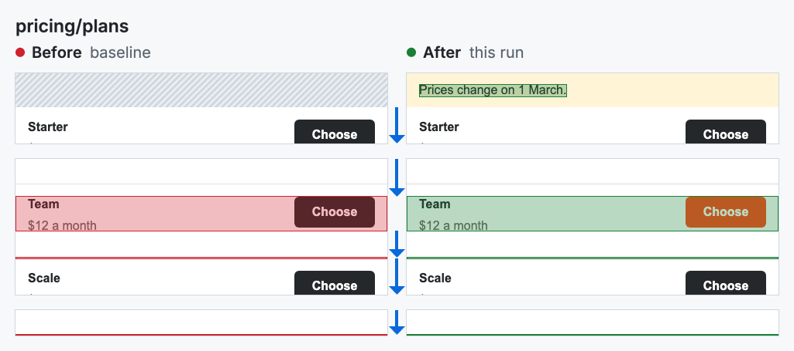

# Visual-review example

This directory is the executable source of the excerpts and pictures on
[Review a visual change](../../docs/path-visual-review.md). Three pricing cards
render in one list, and three things are edited. A notice, `Prices change on 1
March.`, is added above the list. The recommended plan's `Choose` button turns
from charcoal to orange; the other two keep theirs. And the rule under every
card is drawn a few shades darker. Nothing else is edited: the cards move 44
pixels down only because the notice above them is new.

The run tells these apart. The two images are aligned row by row, so the
notice's rows are inserted and the cards under it are compared with the rows
they were, not with the rows that used to sit where they now are. The notice
and the button are **strong** regions, the three rules **faint** ones; the
notice changed in shape, the rest only in colour. The plan names and prices
are **collateral**: they moved, but their own inputs did not. Each region is
placed on its landmark path in the page and on the line its component is
declared at, and the pull-request comment leads with the cause.

## What it produces

Running it regenerates the eight files in [`artifacts/`](artifacts), all of
which are committed:

| before.png | after.png | diff.png |
| --- | --- | --- |
|  |  |  |

[`artifacts/change.png`](artifacts/change.png) is the change sheet: before
beside after, each row level with the row it became, striped filler opposite
the inserted notice, and a blue arrow beside every row that only moved.



[`artifacts/report.json`](artifacts/report.json) is a run report in the shape
`variance run` writes, holding the one observation's record. No shipped command
runs this case end to end, so the script calls the pieces `variance run` calls:
the page's agent through `acquireFromAgent`, the shipped Playwright renderer for
each PNG, `observeRasters` from `@variance-authority/observe`, `changeImages`
from `@variance-authority/png` for the diff and the change sheet, and
`recordOf` from the CLI. It assembles only the run report itself, taking the
engine from that renderer.
[`artifacts/report.txt`](artifacts/report.txt) is what
`variance ask describe --subject pricing/plans` answers over it, word for word:

```text
[changed] pricing/plans
26,230 pixels differ across 2 strong regions in Notice, ChooseButton, and 3 faint regions, 1 changed in shape and 4 only in colour; 44 pixel rows inserted in 1 place, moving the content under them by up to 44 rows, and the subject resized from 480×288 to 480×332

components:
  cause      ChooseButton — geometry, token
      background-color (not declared) → rgb(255 74 25 / 1)
  cause      Notice — added
  cause      PlanCard — geometry, token
      border-bottom-color rgb(226 226 226 / 1) → rgb(216 216 216 / 1)
  collateral PlanName — geometry
  cause      Plans — geometry; box 0 × +44 px
  collateral Price — geometry

  cause      21120px at 0,0 480×44 — Notice
      in main → region "Plans"
      examples/visual-review-case/src/plans.js:78
      shape v1:f1c4133d51a5f6a29ef2b9be9149875d
  cause      3670px at 360,156 104×40 — ChooseButton
      in main → region "Plans" → list item 2 of 3 → button "Choose"
      examples/visual-review-case/src/plans.js:64
      shape v1:f0ceae0539be67e3c965076afb3829ee
  cause      480px at 0,139 480×1 — PlanCard
      in main → region "Plans" → list item 2 of 3
      examples/visual-review-case/src/plans.js:91
      shape v1:2d5eb4341f37d8dc61f20526efaf0df4
  cause      480px at 0,235 480×1 — PlanCard
      in main → region "Plans" → list item 3 of 3
      examples/visual-review-case/src/plans.js:91
      shape v1:2d5eb4341f37d8dc61f20526efaf0df4
  cause      480px at 0,331 480×1 — PlanCard
      in main → region "Plans" → list item 3 of 3
      examples/visual-review-case/src/plans.js:91
      shape v1:2d5eb4341f37d8dc61f20526efaf0df4
```

The headline is the observation's own sentence: the strong regions by
component, the faint ones counted, shape against colour, and the rows the
alignment inserted. `components:` lists each component whose hashes changed, as
a cause or collateral, with the bands it changed in and each declared value
that changed, from → to. Each region after it gives its differing pixels, its
box, its component, its landmark path, the line its component is declared at,
and a fingerprint of its shape.

[`artifacts/comment.md`](artifacts/comment.md) is the pull-request comment
`renderComment` writes over the same report, the body `variance comment`
prints, with its pictures under this repository's `main`.

[`artifacts/provenance.json`](artifacts/provenance.json) records the engine that
painted the two PNGs, the platform it ran on, the components the run named as
causes, and the changed-pixel count the comparison finds between the two
committed PNGs. The counts are checked against those PNGs, not against a fresh
paint: the same engine rasterizes text differently on macOS and Linux.

## What it does not show

One run of three edits. No region carries raster residue: `texture` is what the
pixels show that no component's declared inputs account for, and it is reported
on the region or the observation, never as a component's band —
[Sensitivity](../../docs/sensitivity.md) says what it is. No component's
accessible name or text changed, so no `a11y` or `content` band appears.

## Run it

You need a checkout, `yarn install`, `yarn build` (the example imports the
workspace packages from their build output), and a Chromium binary from
`npx playwright install chromium`.

From the repository root:

```bash
yarn workspace @variance-authority/example-visual-review-case generate
```

It prints the report and rewrites the eight files in `artifacts/`. The package
is private and is not published; `generate` is its only script.

The Vitest file re-runs the same comparison and checks it — the inserted rows,
the causes and the collateral, the grades, each region's landmark path and
line — and that the committed report, apart from its pixel counts, boxes and
shape fingerprints, is the one the run prints. Without a browser it checks that
the committed `report.txt` is what `variance ask describe` answers over the
committed `report.json`, that the pixel counts match the committed PNGs, and
that every documentation page quoting the report still matches it. From the
repository root:

```bash
yarn vitest run --config vitest.chromium.config.mts examples/visual-review-case/src/visual-review.chromium.test.ts
```

Without a Chromium binary it skips every case that paints, with a note, and still
checks the committed artifacts.

## The files

| Path | What it is |
| --- | --- |
| [`src/plans.js`](src/plans.js) | The components and the two variants. Lines 64, 78 and 91 are the lines the report names. |
| [`src/page-agent.js`](src/page-agent.js) | The bundle that runs in the page and mounts each variant. |
| [`page/harness.html`](page/harness.html) | The page the cards are mounted into. |
| [`scripts/run-case.mjs`](scripts/run-case.mjs) | The comparison itself: acquire, render, observe, then the record, the run report, the pictures, the `describe` answer and the comment. |
| [`scripts/generate.mjs`](scripts/generate.mjs) | Writes the result to `artifacts/`. |
| [`src/visual-review.chromium.test.ts`](src/visual-review.chromium.test.ts) | The Vitest file above. |

## Scope

Three cards, three edits, one engine. It shows the reporting shape, how a shift
is told from a change, and how changes are graded; it is not a measurement of
attribution accuracy across an arbitrary application.
