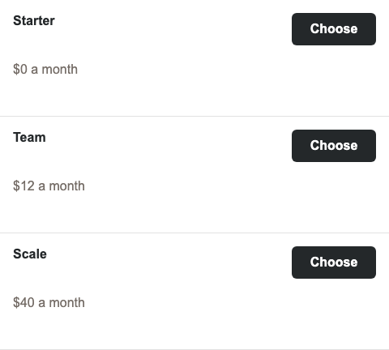

# Visual-review example

This directory is the executable source of the excerpts on
[Review a visual change](../../docs/path-visual-review.md). Three pricing cards
render in one list. Two things are edited. In the second card, the plan's name
grows from `Team` to `Team, billed yearly for every seat` and wraps onto a
second line. And the one accent every `Choose` button is painted in turns from
charcoal to orange, so all three buttons repaint. Nothing else is edited: the
Team card's price moves only because the name above it grew.

The run tells the three apart. The name and the button are **causes**: their
own inputs changed. The price is **collateral**: its pixels moved, but its own
inputs did not. Each component names the bands it changed in, and each region
is placed on its landmark path in the page and on the line its component is
declared at.

## What it produces

Running it regenerates the six files in [`artifacts/`](artifacts), all of which
are committed:

| before.png | after.png | diff.png |
| --- | --- | --- |
|  |  |  |

[`artifacts/report.json`](artifacts/report.json) is a run report in the shape
`variance run` writes, holding the one observation's record. No shipped command
runs this case end to end, so the script calls the pieces `variance run` calls:
the page's agent through `acquireFromAgent`, the shipped Playwright renderer for
each PNG, `observeRasters` from `@variance-authority/observe`, and `recordOf`
from the CLI. It assembles only the run report itself, taking the engine from
that renderer.
[`artifacts/report.txt`](artifacts/report.txt) is what
`variance ask describe --subject pricing/plans` answers over it, word for word:

```text
[changed] pricing/plans
12,267 pixels differ across 5 regions in ChooseButton, PlanName, Price, 2 changed in shape and 3 only in colour

components:
  cause      ChooseButton — token
      background-color rgb(36 40 42 / 1) → rgb(255 74 25 / 1)
  cause      PlanName — a11y, geometry, content
  collateral Price — geometry

  cause      3670px at 360,16 104×40 — ChooseButton
      in main → region "Plans" → list item 1 of 3 → button "Choose"
      examples/visual-review-case/src/plans.js:56
      shape v1:f0ceae0539be67e3c965076afb3829ee
  cause      3670px at 360,160 104×40 — ChooseButton
      in main → region "Plans" → list item 2 of 3 → button "Choose"
      examples/visual-review-case/src/plans.js:56
      shape v1:f0ceae0539be67e3c965076afb3829ee
  cause      3670px at 360,304 104×40 — ChooseButton
      in main → region "Plans" → list item 3 of 3 → button "Choose"
      examples/visual-review-case/src/plans.js:56
      shape v1:f0ceae0539be67e3c965076afb3829ee
  cause      733px at 17,163 166×35 — PlanName
      in main → region "Plans" → list item 2 of 3 → heading "Team, billed yearly for every seat"
      examples/visual-review-case/src/plans.js:33
      shape v1:7aad695648c27135a2385d1af21f4b76
  collateral 524px at 17,223 87×32 — Price
      in main → region "Plans" → list item 2 of 3
      examples/visual-review-case/src/plans.js:45
      shape v1:dcf78d63305c64e488747e46bad7df98
```

The headline is the observation's own sentence. `components:` lists each
component whose hashes changed, as a cause or collateral, with the bands it
changed in and each declared value that changed, from → to. Each region after
it gives its differing pixels, its box, its component, its landmark path, the
line its component is declared at, and a fingerprint of its shape.

[`artifacts/provenance.json`](artifacts/provenance.json) records the engine that
painted the two PNGs, the platform it ran on, the components the run named as
causes, and the changed-pixel count the comparison finds between the two
committed PNGs. The counts are checked against those PNGs, not against a fresh
paint: the same engine rasterizes text differently on macOS and Linux.

## What it does not show

One run of two edits. No component's box grew, so no `box W × H px` appears,
and no region carries raster residue: `texture` is what the pixels show that no
component's declared inputs account for, and it is reported on the region or
the observation, never as a component's band —
[Sensitivity](../../docs/sensitivity.md) says what it is. Those outputs exist in
the report, but this example does not produce them, so it does not show them.

## Run it

You need a checkout, `yarn install`, `yarn build` (the example imports the
workspace packages from their build output), and a Chromium binary from
`npx playwright install chromium`.

From the repository root:

```bash
yarn workspace @variance-authority/example-visual-review-case generate
```

It prints the report and rewrites the six files in `artifacts/`. The package is
private and is not published; `generate` is its only script.

The Vitest file re-runs the same comparison and checks it — the causes, the
collateral price, the bands, each region's landmark path and line — and that
the committed report, apart from its pixel counts, boxes and shape
fingerprints, is the one the run prints. Without a browser it checks that the
committed `report.txt` is what `variance ask describe` answers over the
committed `report.json`, that the pixel counts match the committed PNGs, and
that every documentation page and figure quoting the report still matches it. From the repository root:

```bash
yarn vitest run --config vitest.chromium.config.mts examples/visual-review-case/src/visual-review.chromium.test.ts
```

Without a Chromium binary it skips every case that paints, with a note, and still
checks the committed artifacts.

## The files

| Path | What it is |
| --- | --- |
| [`src/plans.js`](src/plans.js) | The components and the two variants. Lines 33, 45 and 56 are the lines the report names. |
| [`src/page-agent.js`](src/page-agent.js) | The bundle that runs in the page and mounts each variant. |
| [`page/harness.html`](page/harness.html) | The page the cards are mounted into. |
| [`scripts/run-case.mjs`](scripts/run-case.mjs) | The comparison itself: acquire, render, observe, then the record, the run report and the `describe` answer. |
| [`scripts/generate.mjs`](scripts/generate.mjs) | Writes the result to `artifacts/`. |
| [`src/visual-review.chromium.test.ts`](src/visual-review.chromium.test.ts) | The Vitest file above. |

## Scope

Three cards, two edits, one engine. It shows the reporting shape and how a
shift is told from a change; it is not a measurement of attribution accuracy
across an arbitrary application.
