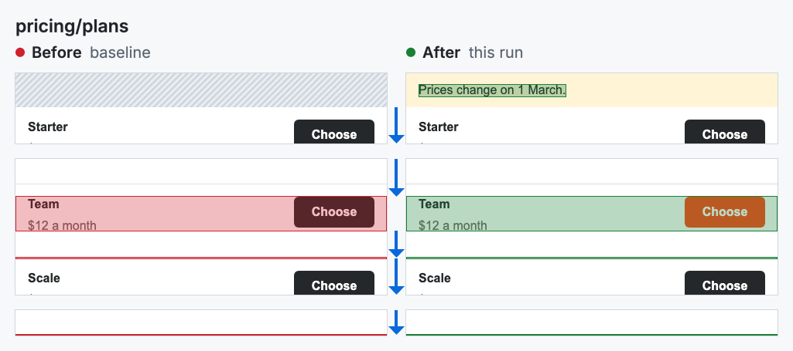

<!-- variance-authority: pr-docket v2 project=visual-review-case -->

## Visual variance in project `visual-review-case` — 1 subject(s) need review

Cause: **`Notice`** at `examples/visual-review-case/src/plans.js:78`

Per subject: `variance report --subject <id>`

Causes, coverage and what painted the images

### Causes

1. **`Notice`** — the cause in 1 subject, 21120px
    `examples/visual-review-case/src/plans.js:78`
    in `main → region "Plans"`
    seen in `pricing/plans`

Collateral: 4 further region(s) (5110px) in 2 component(s) across 1 subject moved with the changes above.

playwright-chromium (chromium@156.0.8078.4, darwin/arm64, 1x) · durable retention · 2026-11-20T10:12:17.311Z

